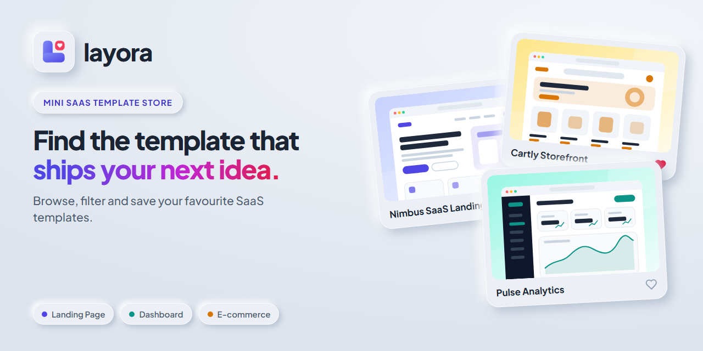
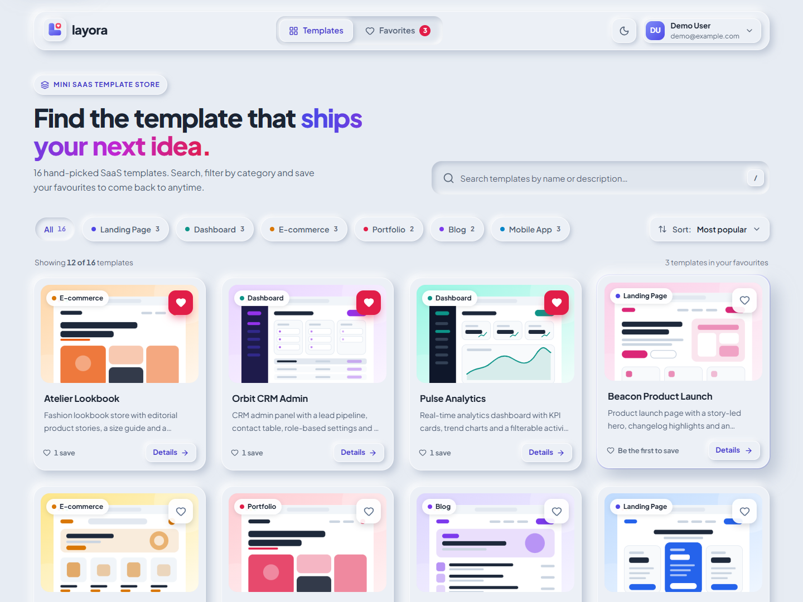
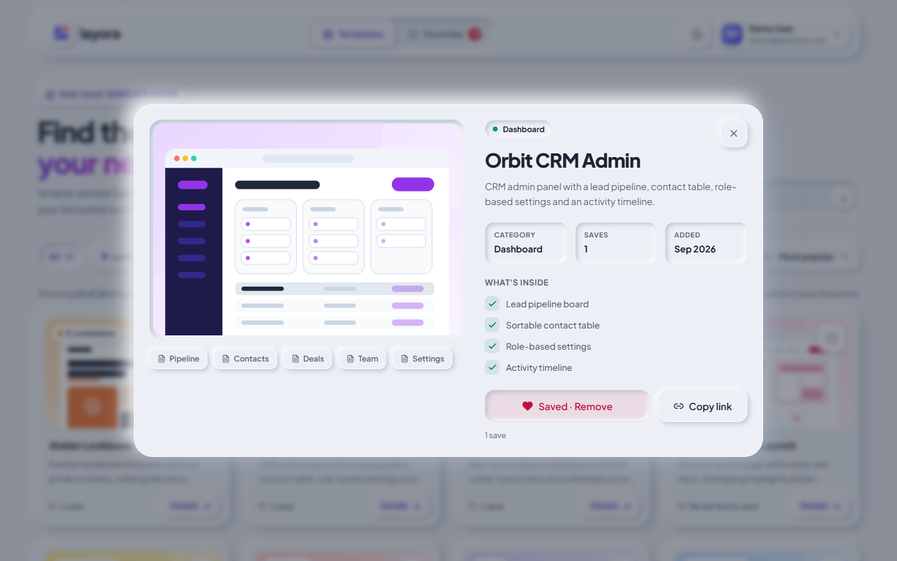
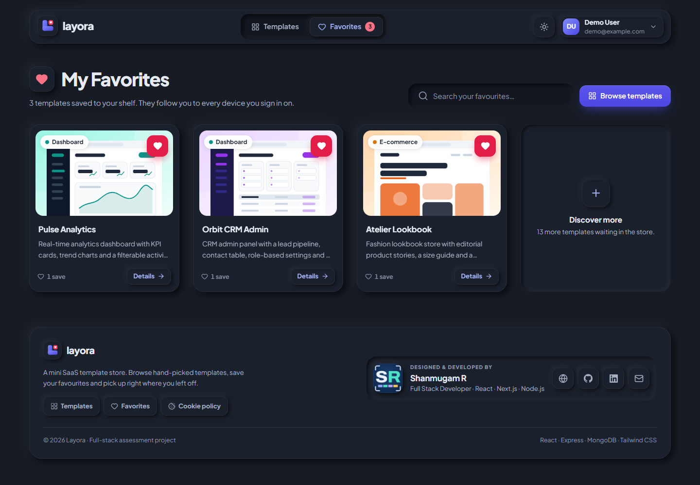
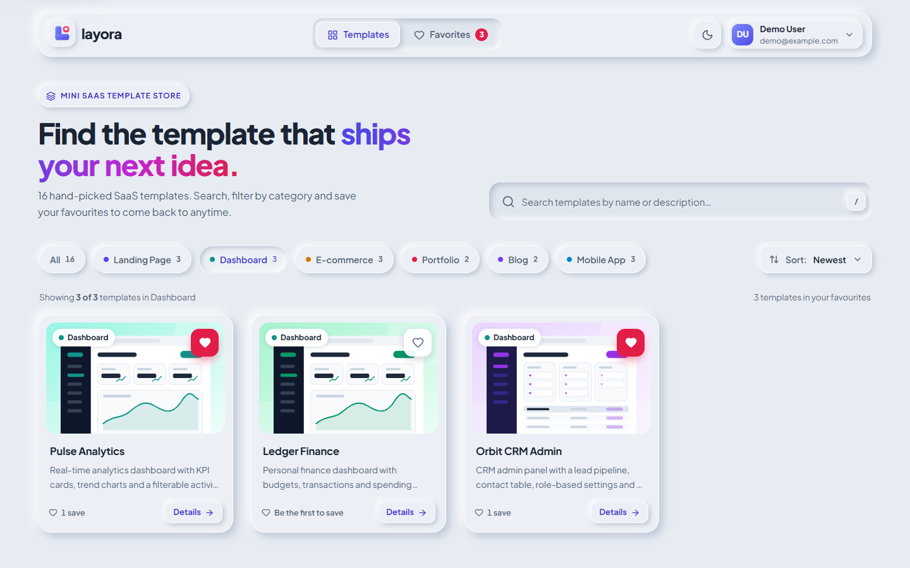
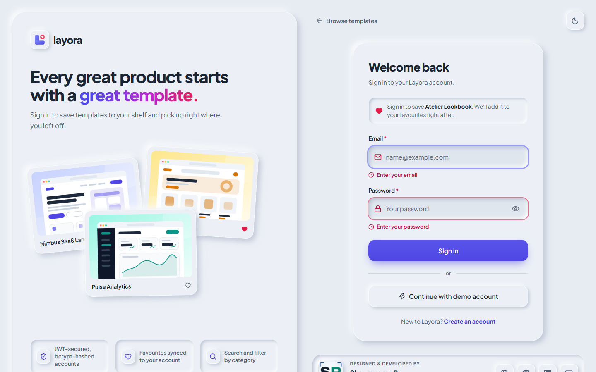
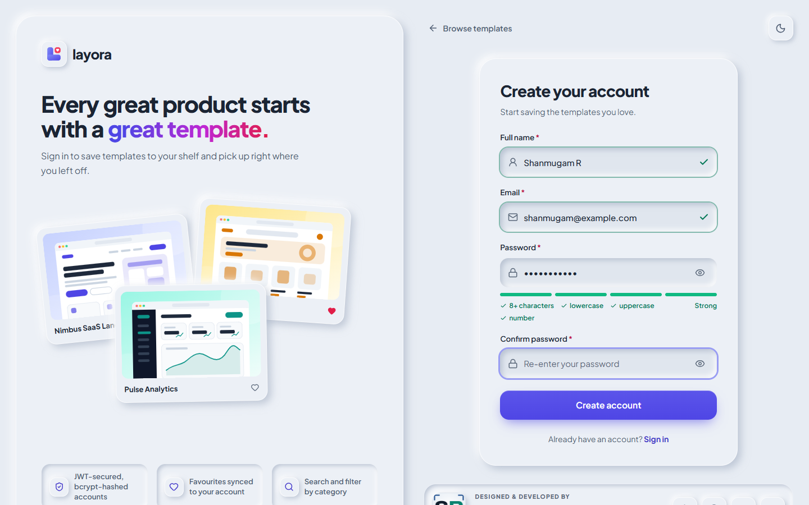
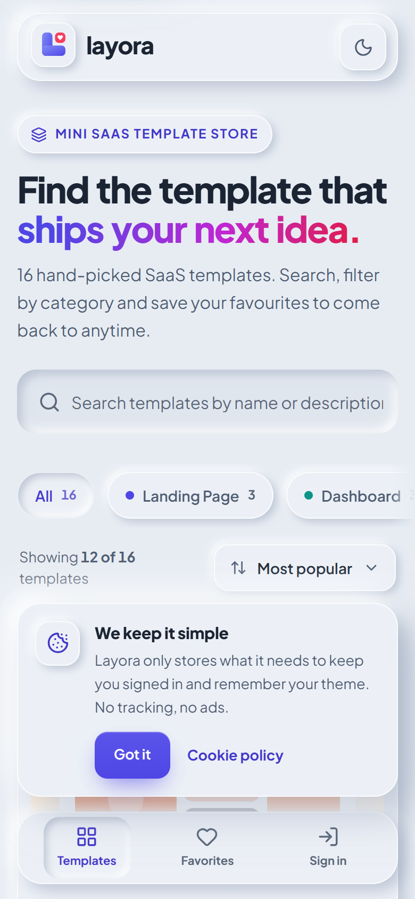
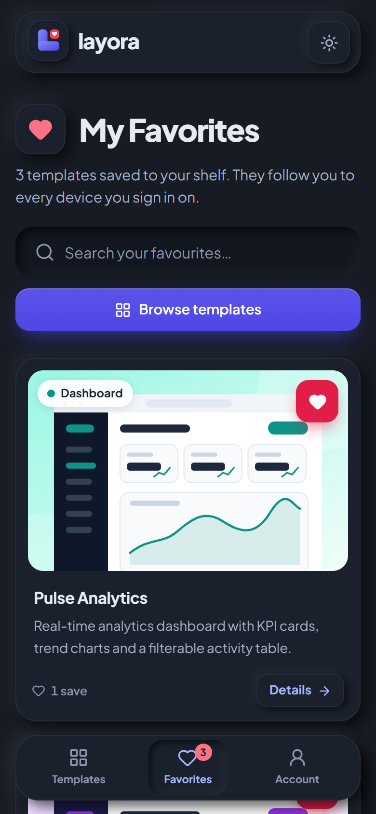

<div align="center">


# Layora · Mini SaaS Template Store

A full-stack template store: browse, search and filter SaaS templates, sign in, and keep a personal shelf of favourites.

**[Live app](https://layora-template-store.vercel.app)** · **[Live API](https://layora-api.onrender.com/api/health)** · **[API docs (Swagger)](https://layora-api.onrender.com/api/docs)**

[](https://github.com/Shanmugamrskfamily/fullstack-intern-task/actions/workflows/ci.yml)


</div>



## Live links

|                       | URL                                                         |
| --------------------- | ----------------------------------------------------------- |
| Web app (Vercel)      | **https://layora-template-store.vercel.app**                |
| API base (Render)     | https://layora-api.onrender.com/api                         |
| API docs (Swagger UI) | https://layora-api.onrender.com/api/docs                    |
| Health check          | https://layora-api.onrender.com/api/health                  |
| Repository            | https://github.com/Shanmugamrskfamily/fullstack-intern-task |

**Demo account:** `demo@example.com` / `Demo@1234`, or click **Continue with demo account** on the sign-in page. It is shared by everyone; create your own account for a clean shelf.

> The API runs on Render's free tier, which sleeps when idle, so the very first request can take up to ~50 seconds. The app shows a **"Waking up the server…"** banner with automatic retries instead of a broken page, and a scheduled GitHub Action pings the API every 10 minutes to keep it warm.

## Reviewer's two-minute tour

1. **Browse.** Type in the search box (or press <kbd>/</kbd>), pick a category chip, change the sort. Filters live in the URL, so a copied link reopens the same view.
2. **Save as a guest.** Tap ♥ while signed out. You are asked to sign in, and the template is saved for you right after.
3. **Sign in** with the demo account. Saved templates show a filled heart; **Details** opens a deep-linkable dialog (`/templates/:id`).
4. **Favorites.** Remove a template, then press **Undo** on the toast.
5. **Theme and cookies.** Switch to dark mode and reload: the choice is remembered. Dismiss the cookie notice: it stays dismissed.
6. **API.** In Swagger UI, call `POST /auth/login` with the demo account, click **Authorize**, and try the favorites endpoints.

## Screenshots

| Catalogue (light)                                     | Template details                                           |
| ----------------------------------------------------- | ---------------------------------------------------------- |
|  |  |
| **Favorites (dark)**                                  | **Category filter + sort in the URL**                      |
|   |          |
| **Sign in: inline validation + guest intent**         | **Sign up: live password strength**                        |
|     |               |

<p align="center">
  
  &nbsp;&nbsp;
  
</p>

## Task requirements → implementation

| Requirement (from the brief)                                           | Implementation                                                                                             |
| ---------------------------------------------------------------------- | ---------------------------------------------------------------------------------------------------------- |
| React (Vite) + Tailwind CSS                                            | React 19 + Vite 8 + **Tailwind CSS v4**, TypeScript strict                                                 |
| Node.js + Express                                                      | Express 5 + TypeScript, layered modules                                                                    |
| Database + ORM                                                         | MongoDB Atlas + **Mongoose 9**                                                                             |
| Register & login, JWT, hashed passwords                                | `POST /api/auth/register`, `POST /api/auth/login`, `GET /api/auth/me`; HS256 JWT; bcrypt cost 12           |
| Templates collection: `id, name, description, thumbnail_url, category` | Exactly these fields in every response (plus `slug`, `features`, `pages`, `favorites_count`, `created_at`) |
| `GET /api/templates`, `GET /api/templates/:id`                         | ✔ with optional `search`, `category`, `sort`, `page`, `limit`                                              |
| `POST /api/favorites/:templateId`, `GET /api/favorites`                | ✔ authenticated; POST is idempotent (201 first time, 200 after); plus `DELETE` to un-favourite             |
| Seed at least 5 templates                                              | **16 templates in 6 categories** with original SVG thumbnails, seeded automatically (and `npm run seed`)   |
| Validate register/login, proper status codes + JSON                    | Strict Zod schemas for every body, query and param; consistent JSON envelope; 400/401/404/409/413/429/503  |
| Pages `/register`, `/login`, `/templates`, `/favorites`                | ✔ plus `/templates/:id` (dialog), `/cookies` and a 404 page                                                |
| JWT stored in localStorage                                             | ✔ (`layora:token`), with the mitigations listed under Security                                             |
| Axios for API calls                                                    | One Axios instance with auth and error interceptors, used through TanStack Query                           |
| Cards with a Favorite button; mark favourited templates                | ♥ toggle with `aria-pressed`, optimistic update and rollback                                               |
| Auth redirects (favorites only for signed-in users)                    | Route guards; guests are sent to sign in and returned to where they were                                   |
| Clean, responsive UI                                                   | Soft UI Evolution design system, light/dark, 375 px → 1440 px, mobile tab bar                              |
| **Bonus:** search / filter by category                                 | Debounced search, category chips with counts, sort; all synced to the URL                                  |
| **Bonus:** logout + protected routes                                   | Account menu with log out; logout syncs across browser tabs                                                |
| **Bonus:** deployment                                                  | API on Render, web app on Vercel, CI on GitHub Actions                                                     |
| README with setup, tech stack, name & contact                          | This file, plus [client/README.md](client/README.md) and [server/README.md](server/README.md)              |

## Beyond the brief

- **UX:** skeleton loaders shaped like the real cards, empty and error states with recovery actions, toasts with **Undo**, a route-driven detail dialog with focus management, `/` search shortcut, keyboard-navigable category chips, mobile bottom tab bar, animated brand loader, reduced-motion support and WCAG AA contrast in both themes.
- **Theme:** light by default; the choice is saved and applied before first paint (no flash) and synced across tabs.
- **Cookie notice:** a gentle, non-blocking card (only strictly necessary storage is used) plus a `/cookies` policy page.
- **Server-waking UX:** health-check banner with backoff retries for the free-tier cold start.
- **Link previews:** Open Graph and Twitter tags with a custom 1200×630 image, so a shared link shows the logo, title and description on WhatsApp, LinkedIn and Slack.
- **API docs:** OpenAPI 3.1 with Swagger UI.
- **Quality:** 218 automated tests (194 API, 24 web), CI on every push, ESLint + Prettier + Conventional Commits enforced by git hooks.

## Tech stack

| Layer    | Choices                                                                                                                                                       |
| -------- | ------------------------------------------------------------------------------------------------------------------------------------------------------------- |
| Web app  | React 19, Vite 8, TypeScript, Tailwind CSS v4, shadcn/ui patterns on Radix UI, TanStack Query 5, Axios, React Router 7, React Hook Form + Zod, Sonner, Lucide |
| API      | Node.js 24, Express 5, TypeScript, Mongoose 9, Zod 4, jsonwebtoken, bcryptjs, helmet, cors, express-rate-limit, pino, Swagger UI                              |
| Database | MongoDB Atlas (production), in-memory MongoDB (local development and tests)                                                                                   |
| Testing  | Vitest, Supertest, React Testing Library, mongodb-memory-server                                                                                               |
| Tooling  | ESLint, Prettier, Husky + lint-staged, Conventional Commits, GitHub Actions                                                                                   |
| Hosting  | Vercel (web), Render (API), MongoDB Atlas                                                                                                                     |

## Architecture

```mermaid
flowchart LR
  subgraph Browser
    UI[React UI<br/>pages + components] --> RQ[TanStack Query cache]
    RQ --> AX[Axios client<br/>auth + error interceptors]
  end
  AX -- HTTPS JSON --> API
  subgraph API[Express API on Render]
    MW[helmet · CORS · rate limit · JSON 10 kB] --> V[validate&#40;Zod&#41;]
    V --> C[controller] --> S[service] --> M[Mongoose model]
  end
  M --> DB[(MongoDB Atlas)]
```



- **API:** feature modules (`auth`, `templates`, `favorites`), each split into routes → validation → controller → service → model, with serializers as response DTOs and a central error handler. See [server/README.md](server/README.md).
- **Web app:** feature folders (`auth`, `templates`, `favorites`, `theme`), server state in TanStack Query, auth/theme in React context, URL as the source of truth for filters. See [client/README.md](client/README.md).

## Project structure

```
fullstack-intern-task/
├── client/                 React + Vite web app (deployed to Vercel)
│   ├── public/             icons, link-preview image, theme pre-paint script
│   ├── src/
│   │   ├── app/            router, query client
│   │   ├── components/     ui primitives, layout, brand, feedback states
│   │   ├── features/       auth, templates, favorites, theme
│   │   ├── lib/            http client, security helpers, storage, utils
│   │   ├── pages/          cookie policy, 404
│   │   └── styles/         Tailwind v4 design tokens
│   └── vercel.json         SPA rewrites, CSP and security headers
├── server/                 Express API (deployed to Render)
│   ├── public/thumbnails/  generated SVG template thumbnails
│   ├── src/
│   │   ├── config/         validated env, MongoDB connection
│   │   ├── middlewares/    validate, authenticate, errors, security, rate limits
│   │   ├── modules/        auth, users, templates, favorites, health
│   │   ├── docs/           OpenAPI 3.1 + Swagger UI
│   │   └── seed/           seed data and seeder
│   └── tests/              integration tests (Vitest + Supertest)
├── docs/                   screenshots and social preview
├── .github/workflows/      CI and keep-warm
├── render.yaml             Render blueprint
└── CONTRIBUTING.md         development guidelines
```

## Getting started

**Prerequisites:** Node.js 22 or newer (24 recommended, see `.nvmrc`) and npm. MongoDB is optional locally.

```bash
git clone https://github.com/Shanmugamrskfamily/fullstack-intern-task.git
cd fullstack-intern-task
npm run setup   # installs root tooling, server and client dependencies
npm run dev     # starts the API (:5000) and the web app (:5173) together
```

Then open **http://localhost:5173** and sign in with the demo account.

- **No database setup needed.** Without `MONGODB_URI`, the API starts an in-memory MongoDB and seeds 16 templates and the demo account (the first run downloads a MongoDB binary).
- **Use your own MongoDB:** copy `server/.env.example` to `server/.env` and set `MONGODB_URI`. Full variable lists are in [server/README.md](server/README.md#environment-variables) and [client/README.md](client/README.md#environment-variables).
- **Swagger UI:** http://localhost:5000/api/docs

| Root script         | What it does                         |
| ------------------- | ------------------------------------ |
| `npm run setup`     | Install all dependencies             |
| `npm run dev`       | Run the API and the web app together |
| `npm test`          | Run the API and web test suites      |
| `npm run lint`      | ESLint in both packages              |
| `npm run typecheck` | TypeScript checks in both packages   |
| `npm run build`     | Production builds of both packages   |

## Testing

| Suite   | Tests | Covers                                                                                                                                                                                             |
| ------- | ----: | -------------------------------------------------------------------------------------------------------------------------------------------------------------------------------------------------- |
| API     |   194 | Auth flows, every validation rule, templates search/filter/sort/pagination, idempotent favorites, JWT tampering and expiry, NoSQL injection, rate limits, CORS, security headers, OpenAPI document |
| Web app |    24 | Open-redirect guard, URL filter sanitising, route guards, guest favourite intent, optimistic favourites, login validation and error mapping, theme persistence, cookie notice                      |

```bash
npm test
```

CI ([`.github/workflows/ci.yml`](.github/workflows/ci.yml)) runs lint, typecheck, tests and builds for both packages on every push.

## Security highlights

- **Every input validated on the server** with strict Zod schemas: unknown keys rejected, text normalised (control and zero-width characters removed), length limits and character allowlists, regex-escaped search, ObjectId checks. Mongoose `sanitizeFilter` and `strictQuery` add defence in depth.
- **Auth:** bcrypt (cost 12), JWT with the algorithm, issuer and audience pinned, timing-safe login (same response and timing for unknown emails), brute-force rate limiting, passwords never returned or logged.
- **HTTP:** helmet headers, CORS allowlist, 10 kB body limit, request IDs, no stack traces in responses. The web app ships a strict Content-Security-Policy (`script-src 'self'`), `frame-ancestors 'none'`, HSTS and related headers.
- **Client:** React escapes all output and an ESLint rule forbids `dangerouslySetInnerHTML`; `?next=` redirects are checked against open redirects; URL parameters are cleaned and validated.
- **Honest trade-off:** the brief asks for the JWT in `localStorage`, so it is stored there. In a production product I would keep a short-lived access token in memory with an httpOnly, SameSite refresh cookie; here the strict CSP and the absence of raw-HTML rendering are what mitigate XSS.

## Design patterns

Layered architecture and feature modules (API) · middleware chain with a `validate(schema)` factory · `createApp()` factory for testable apps · singleton DB connection and Axios instance · custom error class with factory methods · response DTO serializers · provider pattern (auth, theme, query) · custom hooks as the data layer · route guards as layout routes · optimistic updates with rollback · interceptor pattern · query-key factory.

## Deployment

- **API → Render** (`render.yaml`): build `cd server && npm ci --include=dev && npm run build`, start `cd server && npm start`, health check `/api/health`. Secrets (`MONGODB_URI`, `JWT_SECRET`) are set in the Render dashboard, never committed. Templates and the demo account are seeded on boot (idempotent).
- **Web → Vercel** (`client/vercel.json`): root directory `client`, Vite preset, SPA rewrites, CSP and security headers. Public build-time values live in `client/.env.production`.
- **Keep warm:** `.github/workflows/keep-warm.yml` pings the API every 10 minutes.

## Development guidelines

Short-lived feature branches merged with `--no-ff`, Conventional Commits enforced by a `commit-msg` hook, ESLint and Prettier on staged files via `pre-commit`, and CI on every push. Details in [CONTRIBUTING.md](CONTRIBUTING.md).

## Author

**Shanmugam R** · Full Stack Developer (React, Next.js, Node.js) · Chennai, India

- Email: [shanmugamrskfamily@gmail.com](mailto:shanmugamrskfamily@gmail.com)
- Phone: +91 78453 71892
- LinkedIn: [linkedin.com/in/shanmugamrskfamily](https://www.linkedin.com/in/shanmugamrskfamily)
- GitHub: [github.com/Shanmugamrskfamily](https://github.com/Shanmugamrskfamily)
- Portfolio: [shanmugam-portfolio.vercel.app](https://shanmugam-portfolio.vercel.app)

## License

[MIT](LICENSE) © 2026 Shanmugam R
