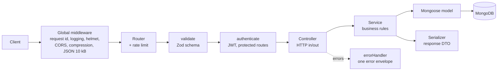

# Layora API

REST API for **Layora**, a Mini SaaS Template Store. Visitors browse, search and filter a catalogue of website and app templates; signed-in users keep a personal list of favorites.

**Live API:** https://layora-api.onrender.com/api · **Swagger UI:** https://layora-api.onrender.com/api/docs · **Web app:** https://layora-template-store.vercel.app

Interactive docs: `/api/docs` (Swagger UI) · OpenAPI 3.1 document: `/api/openapi.json`

---

## Contents

- [Overview](#overview)
- [Tech stack](#tech-stack)
- [Architecture](#architecture)
- [Folder structure](#folder-structure)
- [Getting started](#getting-started)
- [API reference](#api-reference)
- [Responses and errors](#responses-and-errors)
- [Security](#security)
- [Design patterns](#design-patterns)
- [Testing](#testing)
- [Deployment (Render)](#deployment-render)

## Overview

| Area      | What the API does                                                                                                                                                                                               |
| --------- | --------------------------------------------------------------------------------------------------------------------------------------------------------------------------------------------------------------- |
| Auth      | Sign up and sign in with email and password. Returns a JWT session (1 day). `GET /api/auth/me` restores a session.                                                                                              |
| Templates | 16 seeded templates in 6 categories, priced in INR (4 free, 12 paid, 9 with a launch offer). Search by name or description, filter by category or Free/Paid, sort by popularity, date, name or price, paginate. |
| Favorites | Add, list and remove favorites. Add and remove are idempotent, and each template keeps a `favorites_count` that powers the "Most popular" sort.                                                                 |
| Orders    | Demo checkout: buy a paid template or claim a free one. The server computes the price, launch-offer saving, 18% GST and total; repeat purchases return the same order. `GET /api/orders` is the user's library. |
| Ops       | Health check for the platform, request ids on every response, structured JSON logs, graceful shutdown.                                                                                                          |

It runs with **zero configuration** in development: without `MONGODB_URI` it starts an in-memory MongoDB, seeds the catalogue and a demo account, and is ready in seconds.

**Demo account:** `demo@example.com` / `Demo@1234` (starts with three favorites and two templates in its library).

**Sample popularity:** seeded templates start with sample save counts (100 to 500, two at 0) so the catalogue looks lived-in; real favorites are added on top and the counts stay in sync.

## Tech stack

| Concern       | Choice                                                                              |
| ------------- | ----------------------------------------------------------------------------------- |
| Runtime       | Node.js 22+ (24 recommended, see `.nvmrc` at the repo root), ES modules             |
| Language      | TypeScript 6, `strict` with `noUncheckedIndexedAccess`                              |
| Web framework | Express 5 (native async error handling)                                             |
| Database      | MongoDB with Mongoose 9; `mongodb-memory-server` for development and tests          |
| Validation    | Zod 4 (request bodies, query strings, route params and environment variables)       |
| Auth          | `jsonwebtoken` (HS256) and `bcryptjs` (cost 12)                                     |
| Security      | `helmet`, `cors` (allowlist), `express-rate-limit`                                  |
| Logging       | `pino` and `pino-http` (JSON in production, pretty in development, silent in tests) |
| API docs      | OpenAPI 3.1 document in TypeScript, rendered by `swagger-ui-express`                |
| Testing       | Vitest and Supertest against a real in-memory MongoDB                               |
| Tooling       | ESLint (typescript-eslint), Prettier, Husky and lint-staged, Conventional Commits   |

## Architecture

Each request flows through the same layers. Every layer has one job, so the code stays easy to test and change.



| Layer                | Responsibility                                                                                                                    | Example                                   |
| -------------------- | --------------------------------------------------------------------------------------------------------------------------------- | ----------------------------------------- |
| **Routes**           | Map URLs to handlers and attach middleware.                                                                                       | `templates/template.routes.ts`            |
| **Validate (Zod)**   | Parse, sanitise and type `params`, `query` and `body`. Controllers only see the parsed result (`req.valid`), never raw input.     | `middlewares/validate.ts`, `*.schemas.ts` |
| **Controller**       | Thin HTTP adapter: read validated input, call a service, choose the status code and cache headers.                                | `favorites/favorite.controller.ts`        |
| **Service**          | Business rules and data access: idempotent favorites, timing-safe login, search and pagination.                                   | `auth/auth.service.ts`                    |
| **Model**            | Mongoose schema, indexes and constraints (unique email, one favorite per user and template).                                      | `templates/template.model.ts`             |
| **Serializer (DTO)** | Explicit allowlist of the fields sent to clients: `id` instead of `_id`, absolute thumbnail URLs, no internal fields.             | `templates/template.serializer.ts`        |
| **Error handler**    | Translates every thrown value (Zod, Mongoose, body parser, `ApiError`) into one envelope; unexpected errors become a generic 500. | `middlewares/error-handler.ts`            |

Code is organised by **feature module** (`auth`, `users`, `templates`, `favorites`, `orders`, `health`): each module owns its routes, schemas, controller, service, model and serializer.

## Folder structure

```text
server/
├── public/thumbnails/          # Generated SVG previews, served at /static/thumbnails
├── scripts/
│   └── generate-thumbnails.ts  # npm run thumbnails
├── src/
│   ├── app.ts                  # createApp(): middleware, routers, error handling (no listen)
│   ├── server.ts               # Entry point: connect DB, seed, listen, graceful shutdown
│   ├── config/
│   │   ├── env.ts              # Zod-validated environment, fails fast on bad config
│   │   ├── load-env.ts         # Loads .env outside production
│   │   └── db.ts               # MongoDB connection (in-memory fallback), sanitizeFilter
│   ├── docs/
│   │   ├── openapi.ts          # OpenAPI 3.1 document
│   │   └── docs.routes.ts      # GET /api/openapi.json and Swagger UI at /api/docs
│   ├── middlewares/
│   │   ├── authenticate.ts     # Bearer JWT -> req.user
│   │   ├── error-handler.ts    # toApiError(), JSON 404, error envelope
│   │   ├── rate-limit.ts       # API-wide and brute-force limiters
│   │   ├── security.ts         # helmet, CORS allowlist, request logger and ids
│   │   └── validate.ts         # validate({ params, query, body }) with Zod
│   ├── modules/
│   │   ├── auth/               # register, login, me
│   │   ├── favorites/          # list, add, remove
│   │   ├── health/             # GET /api/health
│   │   ├── orders/             # demo checkout and the user's library
│   │   ├── templates/          # list (search, category, price, sort), categories, get by id
│   │   └── users/              # User model and public serializer
│   ├── seed/
│   │   ├── templates.data.ts   # The 16 templates (also drives thumbnails)
│   │   ├── seed.ts             # Idempotent seeding: templates and prices, demo user, favorites, library
│   │   └── run.ts              # npm run seed
│   ├── types/express.d.ts      # req.valid and req.user typings
│   └── utils/                  # ApiError, JWT helpers, logger, text cleaning, ObjectId checks
├── tests/                      # Vitest + Supertest integration tests
├── .env.example
├── eslint.config.js
├── tsconfig.json               # Type checking (src, tests, scripts)
├── tsconfig.build.json         # Build output for src only -> dist/
└── vitest.config.ts
```

## Getting started

### Prerequisites

- Node.js 22 or newer (the repository pins 24 in `.nvmrc`)
- Optional: a MongoDB Atlas connection string. Without one, an in-memory MongoDB is used.

### Run locally

```bash
cd server
npm install
npm run dev
```

The API starts on <http://localhost:5000>. With no `MONGODB_URI` it starts an in-memory MongoDB (the binary is downloaded once and cached), seeds the 16 templates and the demo account, and logs a warning that data resets on restart.

Open <http://localhost:5000/api/docs>, run **POST /auth/login** with the demo account, click **Authorize** and paste the token to try the protected routes.

From the repository root, `npm run setup` installs everything and `npm run dev` starts the API and the web client together.

### Use a real database

```bash
cp .env.example .env
# set MONGODB_URI (and optionally JWT_SECRET) in .env
npm run seed      # upsert templates and the demo account
npm run dev
```

### Environment variables

Every variable is optional in development. In production `MONGODB_URI` and `JWT_SECRET` are required and the server refuses to start without them.

| Variable                | Default                                          | Description                                                                                             |
| ----------------------- | ------------------------------------------------ | ------------------------------------------------------------------------------------------------------- |
| `NODE_ENV`              | `development`                                    | `development`, `test` or `production`.                                                                  |
| `PORT`                  | `5000`                                           | HTTP port.                                                                                              |
| `MONGODB_URI`           | _(unset: in-memory MongoDB)_                     | MongoDB connection string. Required in production.                                                      |
| `MONGODB_DB_NAME`       | `layora`                                         | Database name.                                                                                          |
| `JWT_SECRET`            | _(random per process)_                           | At least 32 characters. Required in production. Without it, sessions reset when the server restarts.    |
| `JWT_EXPIRES_IN`        | `1d`                                             | Session length, such as `15m`, `12h` or `1d`.                                                           |
| `CLIENT_ORIGINS`        | `http://localhost:5173,http://127.0.0.1:5173`    | Comma-separated browser origins allowed by CORS.                                                        |
| `CLIENT_ORIGIN_PATTERN` | _(unset)_                                        | Optional regex for extra origins, such as preview deployments.                                          |
| `PUBLIC_BASE_URL`       | `RENDER_EXTERNAL_URL` or `http://localhost:PORT` | Public URL of the API, used to build absolute `thumbnail_url` values.                                   |
| `SEED_ON_BOOT`          | `true`                                           | Upsert templates and the demo account on startup (safe to repeat).                                      |
| `LOG_LEVEL`             | `debug` (dev), `info` (prod), `silent` (tests)   | pino log level.                                                                                         |
| `TRUST_PROXY`           | `1`                                              | Proxy hops to trust, so rate limits see the real client IP behind Render.                               |
| `DNS_SERVERS`           | (unset)                                          | Optional resolvers, e.g. `8.8.8.8,1.1.1.1`, if `querySrv ECONNREFUSED` blocks `mongodb+srv://` locally. |

### Scripts

| Command              | What it does                                                                                  |
| -------------------- | --------------------------------------------------------------------------------------------- |
| `npm run dev`        | Start with hot reload (`tsx watch`).                                                          |
| `npm run build`      | Compile `src` to `dist/`.                                                                     |
| `npm start`          | Run the compiled server.                                                                      |
| `npm run seed`       | Seed the database in `MONGODB_URI`. Add `-- --fresh` to delete templates and favorites first. |
| `npm run seed:prod`  | Same as `seed`, from the compiled output.                                                     |
| `npm run thumbnails` | Regenerate the SVG thumbnails in `public/thumbnails` from the seed data.                      |
| `npm test`           | Run the test suite once.                                                                      |
| `npm run test:watch` | Run tests in watch mode.                                                                      |
| `npm run lint`       | ESLint.                                                                                       |
| `npm run typecheck`  | TypeScript, without emitting.                                                                 |

## API reference

Base path: `/api`. The complete, interactive reference with schemas and examples is at **`/api/docs`**.

| Method   | Path                     | Auth   | Success                                                            | Errors                                    |
| -------- | ------------------------ | ------ | ------------------------------------------------------------------ | ----------------------------------------- |
| `GET`    | `/health`                | –      | `200` `{ status, database, uptime_seconds, timestamp }`            | `503` when the database is down           |
| `POST`   | `/auth/register`         | –      | `201` `{ user, token, expires_at }`                                | `400`, `409` email taken, `413`           |
| `POST`   | `/auth/login`            | –      | `200` `{ user, token, expires_at }`                                | `400`, `401` `INVALID_CREDENTIALS`, `413` |
| `GET`    | `/auth/me`               | Bearer | `200` `{ user }`                                                   | `401`                                     |
| `GET`    | `/templates`             | –      | `200` `Template[]` with `meta { page, limit, total, total_pages }` | `400` invalid query                       |
| `GET`    | `/templates/categories`  | –      | `200` `[{ slug, name, count }]`                                    | –                                         |
| `GET`    | `/templates/:id`         | –      | `200` `Template`                                                   | `400` malformed id, `404`                 |
| `GET`    | `/favorites`             | Bearer | `200` `FavoriteTemplate[]` (newest first) with `meta { total }`    | `401`                                     |
| `POST`   | `/favorites/:templateId` | Bearer | `201` added, `200` already a favorite                              | `400`, `401`, `404`                       |
| `DELETE` | `/favorites/:templateId` | Bearer | `204` (also when it was not a favorite)                            | `400`, `401`                              |
| `GET`    | `/orders`                | Bearer | `200` `Order[]` (newest first) with `meta { total }`               | `401`                                     |
| `POST`   | `/orders/:templateId`    | Bearer | `201` added to the library, `200` already owned (same order)       | `400` (any body), `401`, `404`            |
| `GET`    | `/openapi.json`          | –      | `200` OpenAPI 3.1 document                                         | –                                         |
| `GET`    | `/docs`                  | –      | Swagger UI                                                         | –                                         |

Every route can also answer `429` (rate limit) and `500`. Thumbnails are served outside `/api` at `/static/thumbnails/<slug>.svg`.

### `GET /api/templates` query parameters

| Parameter  | Values                                                                       | Default   | Notes                                                                                    |
| ---------- | ---------------------------------------------------------------------------- | --------- | ---------------------------------------------------------------------------------------- |
| `search`   | Text, up to 64 characters                                                    | –         | Case-insensitive match on name or description. Matched literally, so `(.*` is just text. |
| `category` | `landing-page`, `dashboard`, `e-commerce`, `portfolio`, `blog`, `mobile-app` | –         | The display name (`Landing Page`) also works, in any letter case.                        |
| `price`    | `free`, `paid`                                                               | –         | Free templates have `price_inr: 0`.                                                      |
| `sort`     | `popular`, `newest`, `name`, `price_asc`, `price_desc`                       | `popular` | `popular`: most saved first, ties by name. Price sorts use the price charged.            |
| `page`     | 1 to 1000                                                                    | `1`       |                                                                                          |
| `limit`    | 1 to 50                                                                      | `50`      |                                                                                          |

Empty values (`?search=`) are ignored. Unknown parameters and repeated parameters (`?category=a&category=b`) are rejected with `400`.

### A template

```json
{
  "id": "6706b1f4c2a8e93d5f1a7b11",
  "name": "Nimbus SaaS Landing",
  "slug": "nimbus-saas-landing",
  "description": "Conversion-focused SaaS landing page with a bold hero, feature grid, pricing table and customer testimonials.",
  "thumbnail_url": "http://localhost:5000/static/thumbnails/nimbus-saas-landing.svg",
  "category": "Landing Page",
  "category_slug": "landing-page",
  "features": ["Hero with product mockup and two calls to action", "Feature grid with icon cards"],
  "pages": ["Home", "Features", "Pricing", "Blog", "Contact"],
  "favorites_count": 482,
  "price_inr": 1499,
  "original_price_inr": 2499,
  "discount_percent": 40,
  "is_free": false,
  "created_at": "2026-10-08T09:00:00.000Z"
}
```

`price_inr` is the price charged, before GST (`0` means free). `original_price_inr` is the list price (M.R.P.) when the template is on a launch offer, otherwise `null`. A `FavoriteTemplate` is the same object plus `favorited_at`.

### An order (demo checkout)

```json
{
  "id": "6706b1f4c2a8e93d5f1a7d31",
  "order_number": "LY-9F3A2C1B",
  "payment": "demo",
  "price_inr": 1499,
  "discount_inr": 1000,
  "gst_inr": 270,
  "total_inr": 1769,
  "purchased_at": "2026-10-14T10:30:00.000Z",
  "template": { "id": "6706b1f4c2a8e93d5f1a7b11", "name": "Nimbus SaaS Landing", "...": "..." }
}
```

No payment provider is involved and no card data is ever received. GST (18%) is charged on the discounted price.

### Quick try with curl

```bash
# Sign in with the demo account and keep the token
TOKEN=$(curl -s -X POST http://localhost:5000/api/auth/login \
  -H "Content-Type: application/json" \
  -d '{"email":"demo@example.com","password":"Demo@1234"}' | node -pe "JSON.parse(require('fs').readFileSync(0)).data.token")

# Dashboards, most popular first, 5 per page
curl -s "http://localhost:5000/api/templates?category=dashboard&limit=5"

# The demo account's favorites
curl -s http://localhost:5000/api/favorites -H "Authorization: Bearer $TOKEN"

# Free templates, and paid ones cheapest first
curl -s "http://localhost:5000/api/templates?price=free"
curl -s "http://localhost:5000/api/templates?price=paid&sort=price_asc"

# The demo account's library (demo purchases)
curl -s http://localhost:5000/api/orders -H "Authorization: Bearer $TOKEN"
```

## Responses and errors

Every JSON response uses one envelope, and all field names are snake_case.

```jsonc
// Success
{ "success": true, "data": { ... }, "meta": { ... }, "message": "Signed in" }

// Error
{
  "success": false,
  "error": {
    "code": "VALIDATION_ERROR",
    "message": "Some fields need your attention",
    "details": [{ "field": "email", "message": "Enter a valid email address, like name@example.com" }],
    "requestId": "3f6c1e2a-8b4d-4c7e-9a1f-2d5b6e7c8a90"
  }
}
```

`meta` and `message` appear only where relevant. `details` lists every invalid field at once, so a form can show all problems together. `requestId` matches the `X-Request-Id` header and the server logs.

| Status | Code                  | When                                                                                             |
| ------ | --------------------- | ------------------------------------------------------------------------------------------------ |
| 400    | `VALIDATION_ERROR`    | A body field, query parameter or route parameter is invalid, unknown or repeated.                |
| 400    | `INVALID_JSON`        | The body is not valid JSON, or is JSON but not an object or array.                               |
| 400    | `BAD_REQUEST`         | Any other malformed request.                                                                     |
| 401    | `UNAUTHORIZED`        | No `Authorization` header on a protected route.                                                  |
| 401    | `INVALID_TOKEN`       | Malformed or tampered token, wrong signature, algorithm, issuer or audience, or deleted account. |
| 401    | `TOKEN_EXPIRED`       | The session expired; sign in again.                                                              |
| 401    | `INVALID_CREDENTIALS` | Wrong email or password (one message for both).                                                  |
| 404    | `NOT_FOUND`           | Unknown template or route.                                                                       |
| 409    | `CONFLICT`            | An account with this email already exists (`details[0].field` is `email`).                       |
| 413    | `PAYLOAD_TOO_LARGE`   | The body is larger than 10 kB.                                                                   |
| 429    | `TOO_MANY_REQUESTS`   | Rate limit reached. `Retry-After` says how long to wait.                                         |
| 500    | `INTERNAL_ERROR`      | Unexpected error. Details are logged, never sent to the client.                                  |

## Security

### Input handling

Every input is validated on the server with a **strict** Zod schema: unknown keys are rejected rather than ignored, which also blocks mass assignment (`role`, `_id`, `password_hash`).

| Input                       | Rules                                                                                                                                                                                                             |
| --------------------------- | ----------------------------------------------------------------------------------------------------------------------------------------------------------------------------------------------------------------- |
| JSON body                   | `application/json` only, 10 kB limit, objects and arrays only (`strict`), malformed JSON is a clean `400`.                                                                                                        |
| `name`                      | `cleanText()` (Unicode NFC, control and zero-width characters removed, whitespace collapsed, trimmed), 2 to 50 characters, letters from any script plus space `.` `'` `-`. Markup such as `<script>` cannot pass. |
| `email`                     | Must be a string (operator objects like `{ "$gt": "" }` are rejected), trimmed, lowercased, at most 254 characters, valid format. Uniqueness is case-insensitive.                                                 |
| `password`                  | Never trimmed or altered. 8 characters to 72 bytes (bcrypt's limit, measured in UTF-8 bytes), with lowercase, uppercase and a number.                                                                             |
| `search`                    | One string, cleaned, at most 64 characters, **regex-escaped** before use: matched literally, so no regex injection or ReDoS.                                                                                      |
| `category`, `price`, `sort` | Allowlists.                                                                                                                                                                                                       |
| `page`, `limit`             | Bounded integers (1 to 1000, 1 to 50).                                                                                                                                                                            |
| Checkout body               | Must be empty (`{}` at most): a client can never send a price, discount or total.                                                                                                                                 |
| `:id`, `:templateId`        | Must be a 24-character hex ObjectId before any database call.                                                                                                                                                     |
| Query string                | Express's `simple` parser: `?search[$ne]=x` never becomes an object, and repeated keys are rejected.                                                                                                              |
| `X-Request-Id` header       | Reused only if it matches `^[\w-]{8,64}$`, otherwise replaced with a UUID (no log injection).                                                                                                                     |

### Database

- `mongoose.set('sanitizeFilter', true)`: any `$` operator that reaches a query filter is wrapped in `$eq`. The API's own operators are explicitly marked with `mongoose.trusted()`.
- `mongoose.set('strictQuery', true)`: unknown fields in filters are dropped.
- `password_hash` has `select: false` and is only loaded by the login query. Response DTOs are explicit allowlists, so it can never be serialised.
- Unique indexes enforce one account per email and one favorite per user and template, even under concurrent requests.

### Authentication

- Passwords are hashed with **bcrypt, cost 12**.
- **Timing-safe login:** an unknown email is still compared against a dummy hash, and both failure cases return the same `INVALID_CREDENTIALS` message, so accounts cannot be discovered by message or timing.
- **JWT** signed with HS256. Verification pins the algorithm (no `none`, no algorithm switching), the issuer (`layora-api`) and the audience (`layora-client`), then checks that the account still exists. Expired tokens get a distinct `TOKEN_EXPIRED` code so the client can prompt a fresh sign-in.
- Production requires a `JWT_SECRET` of at least 32 characters; development generates a random one per process.

### HTTP

- **helmet:** strict Content Security Policy (`default-src 'self'`, `script-src 'self'`, `frame-ancestors 'none'`), HSTS, `nosniff`, `Referrer-Policy: no-referrer`, `Cross-Origin-Resource-Policy: same-site` (thumbnails opt in to `cross-origin`). Swagger UI works under this policy because it loads only same-origin scripts. `X-Powered-By` is disabled.
- **CORS allowlist** from `CLIENT_ORIGINS` (plus an optional regex for preview deployments). Other origins get no CORS headers, so browsers block them.
- **Rate limiting:** 300 requests per 15 minutes per IP across the API, and 10 failed sign-in or sign-up attempts per 15 minutes per IP (successful sign-ins do not count). Standard `RateLimit` headers and `Retry-After` on `429`.
- **Caching:** `/auth/me` is `no-store`, favorites are `private, no-store`, the public catalogue is cached for 30 seconds.

### Operations

- **Log redaction:** `Authorization`, cookies, `password` and `password_hash` never reach the logs.
- **Request ids** on every response and in every log line, echoed in error bodies.
- **No leaked internals:** unexpected errors are logged in full and answered with a generic `500`.
- **Fail-fast config:** environment variables are validated with Zod at startup.

## Design patterns

| Pattern                           | Where                                                                           | Why                                                                                   |
| --------------------------------- | ------------------------------------------------------------------------------- | ------------------------------------------------------------------------------------- |
| Layered architecture              | routes → validate → controller → service → model                                | Each layer has one reason to change; services are free of HTTP details.               |
| Feature modules                   | `src/modules/<feature>/`                                                        | Everything about a feature lives together.                                            |
| Factory                           | `createApp()`, `createAuthRouter()`, `createDocsRouter()`, `createApiLimiter()` | Build fresh, configurable instances; tests create apps with or without rate limits.   |
| Middleware chain                  | `validate`, `authenticate`, `errorHandler`                                      | Cross-cutting concerns stay out of controllers.                                       |
| Higher-order function             | `validate({ params, query, body })`                                             | One reusable validator configured per route with Zod schemas.                         |
| DTO / serializer                  | `toPublicUser()`, `toPublicTemplate()`                                          | Allowlisted output: internal fields can never leak, and the API shape is stable.      |
| Adapter (error translation)       | `toApiError()`                                                                  | Zod, Mongoose and body-parser errors all become one error envelope.                   |
| Custom error with factory methods | `ApiError.notFound()`, `ApiError.conflict()`, …                                 | Expected errors are explicit and carry a stable code.                                 |
| Null object                       | `passThrough` middleware                                                        | Rate limiting can be switched off without `if` statements in the routes.              |
| Strategy (lookup table)           | `SORTS` in `template.service.ts`                                                | Each sort order is data, not branching.                                               |
| Idempotent upsert                 | `addFavorite()` (`$setOnInsert` plus a unique index), `seedTemplates()`         | Safe retries and double clicks; seeding can run on every boot.                        |
| Lazy initialisation               | `getDummyHash()` in `auth.service.ts`                                           | The timing-safe dummy hash is computed once, on first use.                            |
| Module singletons                 | `env`, `logger`, the Mongoose connection                                        | One validated configuration and one connection pool per process.                      |
| Single source of truth            | `CATEGORIES`, `SORT_OPTIONS`, `SEED_TEMPLATES`                                  | Validation, seeding, thumbnails and the OpenAPI document all read the same constants. |
| Graceful shutdown                 | `server.ts`                                                                     | On `SIGTERM`, finish in-flight requests, then close the database pool.                |

## Testing

```bash
npm test             # run once
npm run test:watch   # watch mode
```

The suite runs **real HTTP requests** (Supertest) against `createApp()` and a **real MongoDB**: each test file gets its own in-memory MongoDB, seeded with the template catalogue, and users and favorites are reset after every test. Tests never touch a configured database, even if `MONGODB_URI` is exported. Nothing is mocked except one spy that simulates a database outage for the health check.

214 tests in 9 files:

| File                | Tests | Covers                                                                                                                                                                                                                                                                                                                                                                                                                                                |
| ------------------- | ----: | ----------------------------------------------------------------------------------------------------------------------------------------------------------------------------------------------------------------------------------------------------------------------------------------------------------------------------------------------------------------------------------------------------------------------------------------------------- |
| `health.test.ts`    |     4 | Health payload, `no-store`, `503` when the database is down, API root.                                                                                                                                                                                                                                                                                                                                                                                |
| `auth.test.ts`      |    46 | Sign-up session and bcrypt hash, normalisation (`"  Shanmugam   R "` → `"Shanmugam R"`, lowercased email, invisible characters), names in Tamil, Hindi and accented Latin, rejected names (`<script>`, digits, emoji), email and password rules (72 bytes, not characters), strict bodies, duplicate and concurrent sign-ups, login, identical answers for wrong password and unknown email, `/auth/me`.                                              |
| `templates.test.ts` |    53 | DTO shape and absolute thumbnail URLs, search (case, whitespace, regex metacharacters, 64-character cap), category by slug or label, repeated keys, every sort order (including popularity after favoriting), pagination maths and bounds, categories, lookup by id.                                                                                                                                                                                  |
| `favorites.test.ts` |    21 | Auth required, per-user lists newest first, idempotent add under concurrency, idempotent remove, `favorites_count` bookkeeping, removed templates, `400` and `404` cases.                                                                                                                                                                                                                                                                             |
| `security.test.ts`  |    52 | Tampered, foreign-secret, expired, unsigned (`alg: none`), wrong algorithm, issuer and audience tokens; malformed headers; password never returned; operator objects and nested query keys; mass assignment and prototype pollution; `413` and `INVALID_JSON`; security headers; request ids; CORS allow and deny, preflight; thumbnail headers and path traversal; the login brute-force limiter (`429` on the 11th failure, successes not counted). |
| `pricing.test.ts`   |     6 | Price fields on every template, Free/Paid filters (also combined with a category), both price sorts, launch offers only where the list price is really higher (max 40%), unknown filters and injection attempts rejected.                                                                                                                                                                                                                             |
| `orders.test.ts`    |     9 | Auth required, server-side price with saving and 18% GST, free claims at ₹0, idempotent and racing purchases (one order), a client-sent price rejected, `400` and `404`, per-user libraries newest first.                                                                                                                                                                                                                                             |
| `seed.test.ts`      |     3 | Sample popularity (100 to 500, two templates at 0), counts kept in sync with real favorites, re-seeding is idempotent.                                                                                                                                                                                                                                                                                                                                |
| `docs.test.ts`      |    20 | `/api/openapi.json` and Swagger UI (same-origin scripts only), every route documented with success, `429` and `500` responses, bearer auth on exactly the protected routes, all `$ref`s resolve, and the documented schemas (including `Order` and the price filter) match real responses.                                                                                                                                                            |

A full run takes about 40 seconds locally; most of it is bcrypt at cost 12, kept on purpose so tests exercise the real hashing.

## Deployment (Render)

The API deploys as a Render **Web Service**:

| Setting           | Value                                   |
| ----------------- | --------------------------------------- |
| Root directory    | `server`                                |
| Runtime           | Node                                    |
| Build command     | `npm ci --include=dev && npm run build` |
| Start command     | `npm start`                             |
| Health check path | `/api/health`                           |

Environment variables:

| Variable         | Value                                                                                                           |
| ---------------- | --------------------------------------------------------------------------------------------------------------- |
| `NODE_ENV`       | `production`                                                                                                    |
| `MONGODB_URI`    | MongoDB Atlas connection string (allow Render's outbound IPs in Atlas network access).                          |
| `JWT_SECRET`     | At least 32 random characters: `node -e "console.log(require('crypto').randomBytes(48).toString('base64url'))"` |
| `CLIENT_ORIGINS` | The deployed web client's origin, such as `https://layora.vercel.app`.                                          |

Notes:

- `--include=dev` is needed because TypeScript and the type packages are dev dependencies used by the build.
- `RENDER_EXTERNAL_URL` is set by Render and used for absolute thumbnail URLs; set `PUBLIC_BASE_URL` to use a custom domain instead.
- With `SEED_ON_BOOT=true` (the default) each deploy upserts the catalogue and the demo account, so a fresh database is ready immediately. Run `npm run seed:prod -- --fresh` from a Render shell to rebuild the catalogue from scratch.
- `TRUST_PROXY=1` (the default) matches Render's single proxy hop, so rate limits apply per client IP.
- Render sends `SIGTERM` on redeploys; the server stops accepting connections, finishes in-flight requests and closes the database pool.
